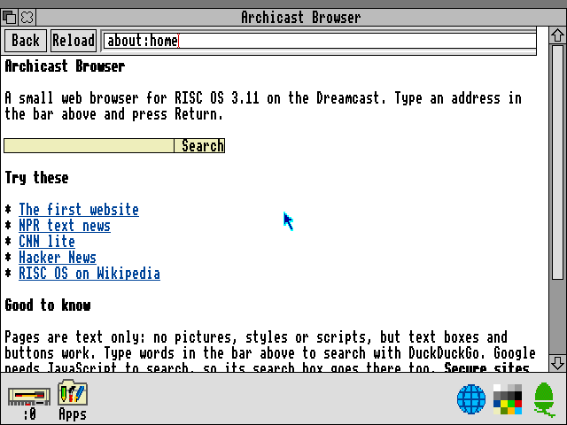
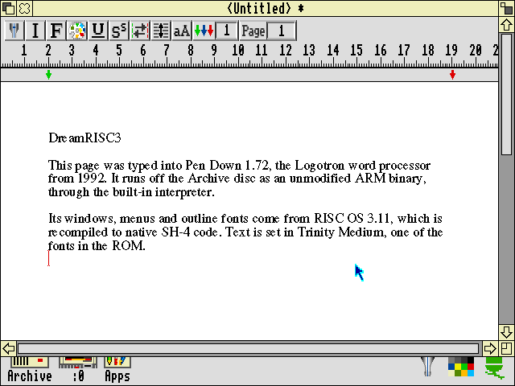
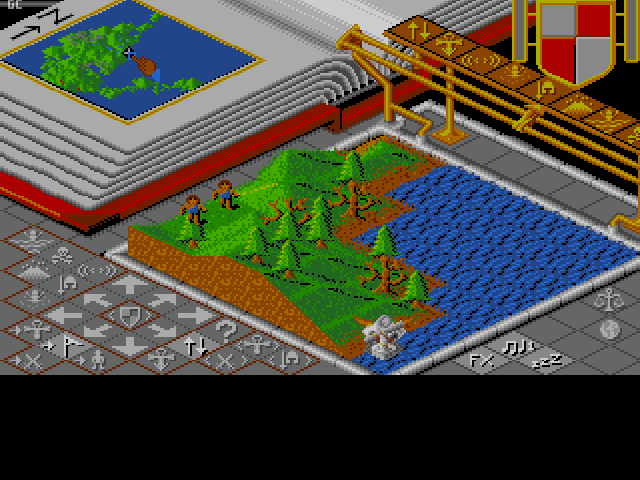

# DreamRISC3

RISC OS 3.11 running natively on the Sega Dreamcast, built on KallistiOS.

**RISC OS itself is not emulated, and there is no JIT.** The Acorn ROM is ARM code with no public source, so a tool recompiles it ahead of time into C and then SH-4. The ELF holds the native code, and the original hardware pokes land in native drivers.

It's also backward compatible with real Archimedes software. The ROM and bundled apps run as native SH-4, and anything without a recompiled block drops into a built-in ARM interpreter, with nothing for the user to launch or configure. Original binaries run unmodified from their disk images, and their RISC OS calls still land in the native ROM. The archive disc carries 261 titles this way.  

The split pays off in performance: the OS and anything built into the image run as native SH-4, while legacy software still works through the interpreter.

<table>
  <tr>
    <td></td>
    <td></td>
  </tr>
  <tr>
    <td></td>
    <td></td>
  </tr>
  <tr>
    <td></td>
    <td></td>
  </tr>
</table>

## Status

- **Runs on a real Dreamcast**: boots to the desktop in ~20s
- **Display**: the desktop runs in mode 27, a true 640x480 in 16 colours. Lower resolution modes, like Lander's, are stretched to fit
- **Sound** plays through the AICA, covering beeps, BASIC's `SOUND` and anything else using the RISC OS sound system
- **Storage**: an SD card on the serial port adapter becomes a usable ADFS hard disc at `:4`, up to ~476MB, and saves survive power off. **Formatting erases the whole card**; the first boot asks first (A/Y to format, B/N to skip). With no card, saves go to floppy `:0` and are lost at power off
- **Software archive**: 261 Archimedes games, apps, demos and compilations from archive.org, on a read-only virtual hard disc called `Archive` at `:4`, or `:5` with an SD card. They run through an interpreter. About a dozen have been tested, including Lemmings, Elite, Populous and Maestro; the rest are untested. Anything that needs its floppy or checks copy protection won't run.
- **Apps folder**: `!Draw`, `!Paint`, Lander, Tertis (SICK, 1993) and Logo, a turtle graphics language with six demos. Lander holds 25 frames/s on the console.
- **Network**: `!Ping` and `!NetSetup`. A Broadband or LAN Adapter comes up by itself with DHCP; the modem (DreamPi) and W5500 are picked in `!NetSetup`.
- **Web**: `!Web` is a small text browser with HTTP, HTTPS, forms and search. Google, DuckDuckGo, Hacker News and Wikipedia work in Flycast, and real sites have loaded on a console. HTTPS is encrypted but certificates are not verified, so don't use it for anything private
- **Printing**: `!NetPrint` prints to an AirPrint printer over the network, from `!Edit`, `!Draw` and anything else using the RISC OS printer drivers. 300dpi black and white, and you type in the printer's address. A real Brother HL-L2305 has successfully printed! See [docs/printing.md](docs/printing.md)

## Build

You need your own RISC OS 3.11 ROM. It is never committed. Default location is `../arculator-mac/roms/riscos311`; override with `ROM_DIR`.

The directory needs these four 512KB chip dumps, named exactly as shown (`IC26.rom` really is lower case):

| File | Size (bytes) | CRC32 | SHA-1 |
| --- | --- | --- | --- |
| `IC24.ROM` | 524288 | `c1adde84` | `12d060e0401dd0523d44453f947bdc55dd2c3240` |
| `IC25.ROM` | 524288 | `15d89664` | `78f5d0e6f1e8ee603317807f53ff8fe65a3b3518` |
| `IC26.rom` | 524288 | `a81ceb7c` | `46b870876bc1f68f242726415f0c49fef7be0c72` |
| `IC27.ROM` | 524288 | `707b0c6c` | `345199a33fed23996374b9db8170a52ab63f0380` |

The first build downloads bundled apps, pinned by hash, into `build/upstream/`.

Host tools: KallistiOS, Python 3, meson, ninja, pkg-config and libisofs (`brew install meson ninja pkg-config libisofs`). The disc-image tool mkdcdisc is vendored under [tools/mkdcdisc](tools/mkdcdisc/VENDOR.md) and built into `build/mkdcdisc/` on first run; set `MKDCDISC` to use another binary.

```bash
scripts/build-dc.sh
```

The first build downloads ~600MB of archive software from archive.org. To leave it out, pass `--include-archive-software off`.

```bash
scripts/run-flycast.sh
```

`scripts/stop-flycast.sh` stops only the instance this checkout launched.

Controls: mouse left/right/middle are Select/Menu/Adjust. On a controller, stick or D-pad moves the pointer, A/B/X are Select/Menu/Adjust, Start is Escape and Y is Return.

See [docs/ARCHITECTURE.md](docs/ARCHITECTURE.md) for how it works and how to test it.
